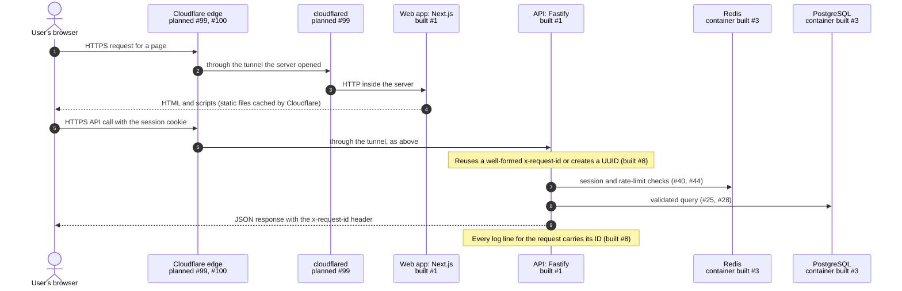
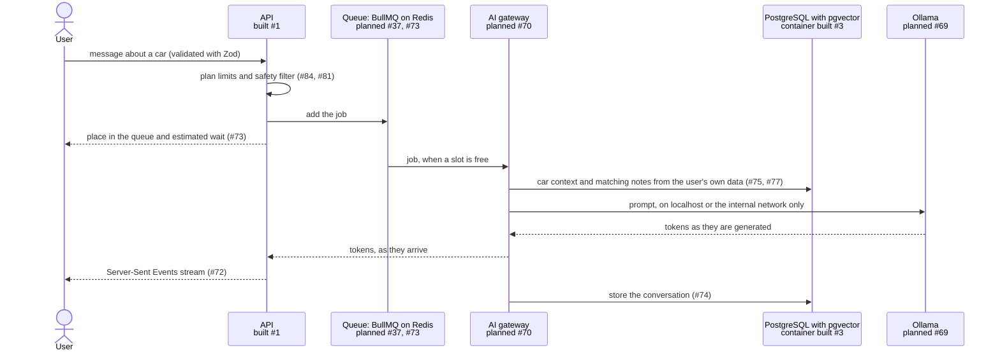
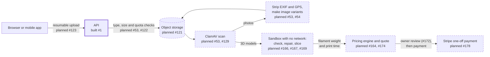
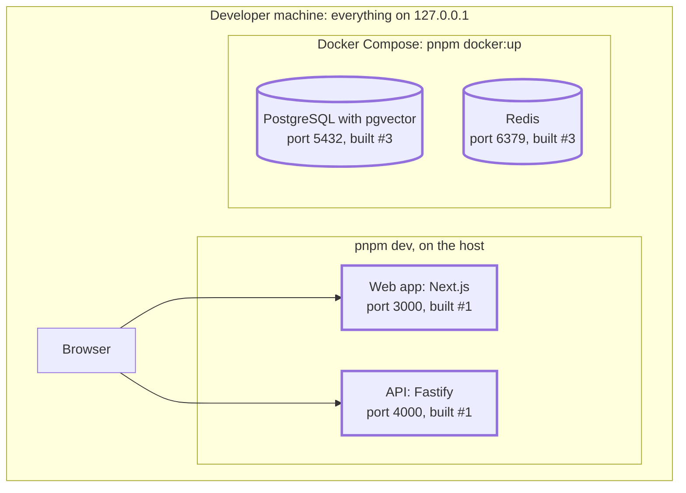
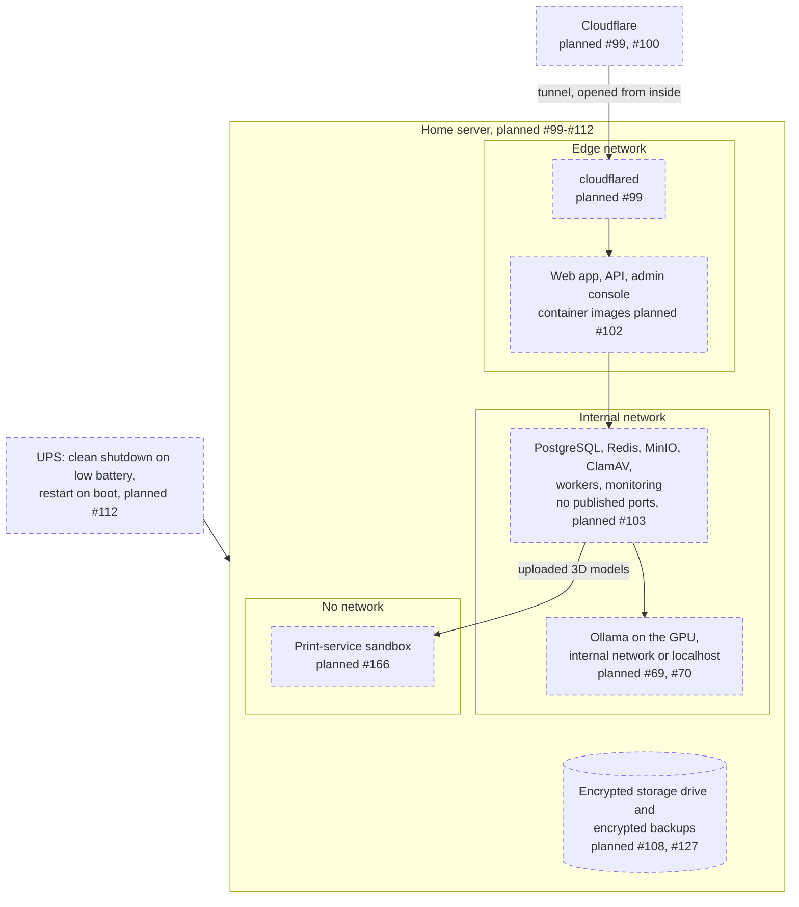

# Architecture

How Apex Garage fits together: what exists now, what the playbook ([PLAYBOOK.md](PLAYBOOK.md))
adds later, where the trust boundaries are and how a request travels through the system.
Instruction 6 created this document. Every instruction that adds or changes a component updates
it (see [Keeping this document current](#keeping-this-document-current)).

**Status labels.** "Built #N" means the component exists in the repository and names the
instruction that added it; "planned #N" names the instruction that will add it. The labels
describe the repository as of Phase 0 (instructions 1 to 8). In the flowcharts, built components
have thick solid borders and planned ones dashed borders (sequence diagrams cannot style their
participants). In every diagram the label of each component says "built", "planned" or (for one
optional service) "possible later" as well, so line style is never the only signal.

## Principles

- **One home server, no open ports.** Everything runs in Docker Compose on the owner's server. The
  only way in from the internet is Cloudflare Tunnel, a connection the server opens outwards, so
  the router forwards no ports (#99).
- **Data and AI stay inside.** PostgreSQL, Redis, object storage, ClamAV and Ollama are never
  reachable from the internet. Only the API and its background workers use them, over an
  internal Docker network (#70, #103, #121). The AI gateway is the only code that talks to Ollama
  (#70).
- **The owner's controls are private.** The admin console has its own hostname behind Cloudflare
  Access and/or Tailscale, and is never linked from the public app (#189, #190). SSH goes over
  Tailscale only (#105).
- **Untrusted input is checked at the edge of each component.** Zod validates every input (Master
  Context). Uploaded files are scanned, and 3D models are processed in a sandbox with no network
  (#53, #166). Prices and limits are computed on the server, never trusted from a client (#84,
  #164).
- **Every log line is structured.** The API writes JSON lines that carry the request's ID, with
  secrets redacted (built #8, see [Observability](#observability)).

## System overview

Every component in the playbook, grouped by network zone. Arrows show the direction in which
requests travel. Today only two of these connections exist: browsers load the web app, and
clients call the API's `/health` route. The API does not use PostgreSQL or Redis yet.

```mermaid
flowchart TB
  classDef built stroke-width:3px
  classDef planned stroke-dasharray:6 4

  subgraph Z1["Internet: untrusted"]
    users["Users' browsers<br/>(web app, installable PWA)"]
    mobile["Mobile app: Expo<br/>planned #134"]:::planned
    owner["Owner's phone and laptop"]
  end

  subgraph Z2["Cloudflare: edge provider"]
    edge["Edge: DNS, TLS, CDN,<br/>WAF and rate limits<br/>planned #99, #100"]:::planned
    access["Cloudflare Access<br/>admin hostname only<br/>planned #190"]:::planned
  end

  tailnet["Tailscale: the owner's<br/>private network<br/>planned #105, #190"]:::planned

  subgraph Z3["Home server: Docker Compose"]
    subgraph Z3a["Edge network: entry from the tunnel or Tailscale"]
      tunnel["cloudflared<br/>tunnel connector<br/>planned #99"]:::planned
      web["Web app: Next.js<br/>built #1"]:::built
      api["API: Fastify<br/>built #1, logging built #8"]:::built
      admin["Admin console<br/>planned #189"]:::planned
    end
    subgraph Z3b["Internal network: no published ports"]
      worker["Queue worker: BullMQ<br/>planned #37, #73"]:::planned
      gateway["AI gateway<br/>planned #70"]:::planned
      ollama["Ollama: local LLM<br/>planned #69"]:::planned
      pg[("PostgreSQL with pgvector<br/>container built #3<br/>schema planned #25")]:::built
      redis[("Redis<br/>container built #3")]:::built
      minio[("Object storage: MinIO<br/>planned #121")]:::planned
      clamav["ClamAV virus scanner<br/>planned #53, #129"]:::planned
      agent["Remote-actions agent<br/>planned #202"]:::planned
      monitor["Monitoring: Uptime Kuma,<br/>Prometheus, Grafana<br/>planned #86, #109, #130"]:::planned
      backup["Backup jobs<br/>planned #38, #108"]:::planned
    end
    subgraph Z3c["Sandbox: no network"]
      sandbox["Mesh checks and slicer<br/>planned #166, #167, #169"]:::planned
    end
  end

  subgraph Z4["Third-party services"]
    stripe["Stripe: Checkout, Portal, webhooks<br/>planned #89-#98, #178"]:::planned
    email["Email provider<br/>planned #39, #59"]:::planned
    oauth["Google sign-in<br/>planned #43"]:::planned
    push["Push services: web push,<br/>Expo, APNs, FCM<br/>planned #59, #152"]:::planned
    social["Instagram Graph API<br/>planned #150"]:::planned
    maps["Map tiles<br/>planned #140"]:::planned
    carrier["Carrier API for labels<br/>possible later (#175)"]:::planned
  end

  offsite[("Off-site encrypted<br/>backup copies<br/>planned #108, #128")]:::planned

  users -->|HTTPS| edge
  mobile -->|HTTPS| edge
  users --> maps
  owner -->|"HTTPS and MFA"| access
  owner -->|WireGuard| tailnet
  edge -->|"tunnel opened<br/>by the server"| tunnel
  access -->|tunnel| admin
  tailnet --> admin
  tunnel --> web
  tunnel --> api
  web -->|"server-side calls"| api
  admin --> api
  admin --> agent
  api --> pg
  api --> redis
  api --> minio
  api --> clamav
  worker --> redis
  worker --> pg
  worker --> gateway
  gateway --> ollama
  worker --> sandbox
  monitor --> api
  backup --> pg
  backup --> minio
  backup --> offsite
  api -->|"HTTPS APIs"| Z4
  stripe -->|"signed webhooks"| edge
```



| Component                       | What it does                                                                                                                                               | Status                                                      |
| ------------------------------- | ---------------------------------------------------------------------------------------------------------------------------------------------------------- | ----------------------------------------------------------- |
| Web app (`apps/web`)            | Next.js App Router app. A placeholder page today; Phase 1 adds the design system and shell. It is to become an installable PWA with offline support (#64). | Built #1                                                    |
| API (`apps/api`)                | Fastify HTTP API: `/health` today; routes, validation and OpenAPI from Phase 2. Logs JSON lines with request IDs.                                          | Built #1, #8                                                |
| Shared code (`packages/shared`) | Zod schemas, types and helpers used by the apps; the typed API client later (#29).                                                                         | Built #1                                                    |
| Design system (`packages/ui`)   | Tokens and components shared by the web app, the admin console and the mobile app.                                                                         | Planned #9                                                  |
| Mobile app (`apps/mobile`)      | Expo app for background GPS journeys and push notifications, sharing types and the API client (#134-#136).                                                 | Planned #134                                                |
| Admin console (`apps/admin`)    | The owner's console: config store, feature flags, audit log, approved remote actions (#189-#211).                                                          | Planned #189                                                |
| Queue worker (BullMQ)           | Background jobs with retries and dead-letter handling (#37): image variants, reminders, slicing, AI chat.                                                  | Planned #37, #73                                            |
| AI gateway                      | The only code allowed to call Ollama (#70), behind a queue with per-user limits (#73).                                                                     | Planned #70                                                 |
| Ollama                          | The local LLM for Crew Chief, listening on localhost or an internal network only (#69, #70).                                                               | Planned #69                                                 |
| PostgreSQL with pgvector        | The main database, and vector search for retrieval over a user's own notes (#77).                                                                          | Container built #3; schema planned #25                      |
| Redis                           | Job queues, rate limits, sessions, caches and leaderboards.                                                                                                | Container built #3                                          |
| Object storage (MinIO)          | Photos, files and 3D models behind a storage interface, so it can be swapped for Backblaze B2 or Cloudflare R2 (#121).                                     | Planned #121                                                |
| ClamAV                          | Scans every upload (#53, #129).                                                                                                                            | Planned #53, #129                                           |
| Print-service sandbox           | Validates and repairs 3D models and slices them with a headless slicer, in a container with no network and strict limits (#166-#169).                      | Planned #166, #167, #169                                    |
| Cloudflare                      | DNS, TLS and CDN for static assets; WAF, bot protection and rate limits (#100); Tunnel (#99); Access for the admin hostname (#190).                        | Planned #99, #100, #190                                     |
| Tailscale                       | The owner's private network for SSH and the admin console (#105, #190).                                                                                    | Planned #105, #190                                          |
| Monitoring                      | Uptime Kuma, Prometheus and Grafana; GPU and capacity monitoring and alerts to the owner's phone (#86, #109, #130).                                        | Planned #86, #109, #130                                     |
| Backups                         | Scheduled, encrypted `pg_dump` with restore tests, encrypted off-site copies and monthly restore drills (#38, #108, #128).                                 | Planned #38, #108, #128                                     |
| Remote-actions agent            | Runs a fixed list of approved operations for the admin console, with narrow permissions (#202).                                                            | Planned #202                                                |
| Stripe                          | Subscriptions (#89-#98) and print-service payments (#178).                                                                                                 | Planned #89-#98, #178                                       |
| Email provider                  | Verification, password resets, reminders and notices (#39, #41, #59, #95). Not chosen yet.                                                                 | Planned #39, #59                                            |
| Other services                  | Google sign-in (#43), push services (#59, #152), the Instagram Graph API (#150) and map tiles (#140). #175 leaves room for a carrier API that buys labels. | Planned #43, #59, #140, #150, #152                          |
| GitHub and GitHub Actions       | Hosts the repository and runs CI on every push to main and every pull request.                                                                             | Workflow built #5; the repository itself is an owner action |

## Network zones and trust boundaries

| Zone                      | What runs there                                                   | Who can reach it                                                    |
| ------------------------- | ----------------------------------------------------------------- | ------------------------------------------------------------------- |
| Internet                  | Users' browsers and phones. Everything from here is untrusted.    | Anyone                                                              |
| Cloudflare edge           | DNS, TLS, CDN, WAF, the tunnel's public end, Access               | The internet                                                        |
| Tailscale network         | The owner's devices and the server                                | The owner's devices only                                            |
| Home network              | The server and the router, which forwards no ports                | Devices on the home network                                         |
| Edge network (Docker)     | cloudflared, the web app, the API and the admin console           | cloudflared, from the tunnel; the admin console also over Tailscale |
| Internal network (Docker) | Databases, queues, storage, scanners, Ollama, workers, monitoring | Services on the same network only; no published ports               |
| Sandbox                   | Processing of uploaded 3D models                                  | Nothing: it has no network at all                                   |
| Off-site storage          | Encrypted backup copies                                           | The server (to write) and the owner (to restore)                    |

The network names are the expected layout; instructions 102 and 103 settle the details. The
boundaries between zones, and what guards each one:

| Boundary                       | Controls                                                                                                                                                                            | Status                                                                                                     |
| ------------------------------ | ----------------------------------------------------------------------------------------------------------------------------------------------------------------------------------- | ---------------------------------------------------------------------------------------------------------- |
| Internet to Cloudflare         | TLS, WAF rules, bot protection, rate limiting and "under attack" mode.                                                                                                              | Planned #100                                                                                               |
| Cloudflare to the home server  | The tunnel is opened from inside, so no inbound port is open. Only cloudflared reaches the apps.                                                                                    | Planned #99                                                                                                |
| Clients to the API             | Zod validation of every input, request IDs and redacted logs, central authorization, rate limits and lockout, CSRF protection and security headers.                                 | Request IDs and redacted logs built #8; route validation planned #28; the rest planned #44, #45, #48, #101 |
| Apps to data and AI services   | An internal Docker network with no published ports; only the API and its workers connect, each service with its own credentials. In development the ports listen on 127.0.0.1 only. | Loopback-only ports built #3; internal network planned #103, #104                                          |
| Uploaded files                 | Type and size checks, ClamAV, EXIF and GPS stripping; 3D models are processed in a sandbox with no network, no root and strict CPU, memory and time limits.                         | Planned #53, #129, #166                                                                                    |
| The owner to the admin console | A separate hostname behind Cloudflare Access and/or Tailscale, passkeys, re-authentication for dangerous actions, and an append-only audit log.                                     | Planned #189-#193                                                                                          |
| The server to third parties    | Outbound HTTPS with secrets from the secret store; Stripe webhooks are accepted only with a valid signature.                                                                        | Planned #91, #104                                                                                          |
| The server to off-site storage | Backups are encrypted before they leave the server, with the key stored separately.                                                                                                 | Planned #108                                                                                               |
| Containers to the host         | Non-root containers with read-only filesystems, dropped capabilities and resource limits; host firewall that denies by default; SSH over Tailscale only.                            | Planned #102, #105                                                                                         |

## Request flow

A page view and an API call once the app is deployed. The API assigns the request ID when the
call reaches it (step 6), and every step after that logs under the ID. Today there is no
Cloudflare or cloudflared: the browser loads the web app straight from 127.0.0.1:3000, clients
call the API on 127.0.0.1:4000, and the API does not use Redis or PostgreSQL yet.



Whether the browser calls the API on its own hostname or through a path of the web app's
hostname is decided with cookies and CSRF protection in instructions 27 and 40.

### Crew Chief chat

Ollama sits behind a queue (playbook section 2), and the AI gateway is the only code that calls it
(#70). Whether the gateway runs in the API process or in a separate worker process is decided in
instructions 70 and 73.



### Uploads and the print service



## Data stores

| Store                    | Holds                                                                                                                                                                                                                            | Status                                                                         | Used by                                                    |
| ------------------------ | -------------------------------------------------------------------------------------------------------------------------------------------------------------------------------------------------------------------------------- | ------------------------------------------------------------------------------ | ---------------------------------------------------------- |
| PostgreSQL with pgvector | Accounts, cars, build entries, parts, maintenance, reminders, photo records, conversations and subscriptions (#25); embeddings (#77); journeys (#137); print orders (#161); config, feature flags and the audit log (#193-#195). | Container built #3; schema planned #25, migrations #26                         | The API and its workers                                    |
| Redis                    | Job queues (#37), rate limits (#44), sessions (#40), caches with explicit invalidation (#35) and leaderboards (#147).                                                                                                            | Container built #3                                                             | The API and its workers                                    |
| Object storage (MinIO)   | Photos, files, 3D models and exports, with per-user quotas (#122) and per-user encryption of file contents (#127).                                                                                                               | Planned #121                                                                   | The API only                                               |
| Docker volumes           | The data of the stores above, on the server's disks.                                                                                                                                                                             | Named volumes built #3; full-disk encryption of the storage drive planned #127 | Docker                                                     |
| Logs                     | JSON lines from the API on standard output, with request IDs, and secrets redacted by key name and URL part.                                                                                                                     | Built #8; alerts and the admin console's log view planned #109, #201           | A terminal; `docker compose logs` and monitoring from #102 |
| Backups                  | Encrypted database dumps and storage copies, kept locally and off-site.                                                                                                                                                          | Planned #38, #108, #128                                                        | Backup jobs; the owner for restores                        |

Nothing outside the internal network reads a data store directly: the web app, the admin console
and the mobile app all go through the API.

## Deployment

### Today: a developer machine



The apps run on the host with `pnpm dev`. Docker Compose runs PostgreSQL and Redis with named
volumes and health checks, their ports published on 127.0.0.1 only; `pnpm docker:up` (#7) starts
them and waits until both are healthy. The apps do not use them until Phase 2, so `pnpm dev`
works without Docker for now. The `api` and `web` services in the `app` profile are placeholders
until the apps get container images. Every port can be changed (`WEB_PORT`, `API_PORT`,
`POSTGRES_PORT`, `REDIS_PORT`), so several checkouts can run side by side. See
[infra/README.md](../infra/README.md).

### Target: the home server

The playbook's hosting plan (Phase 7): one Linux server running Docker Compose, reached only
through Cloudflare Tunnel, with the owner's own access over Tailscale.



- Containers run as non-root users with read-only filesystems, dropped capabilities and resource
  limits (#102); secrets come from Docker secrets or an encrypted file, never from the repository
  (#104).
- The host updates itself, denies inbound traffic by default, allows SSH only over Tailscale, and
  runs the services as a separate non-admin user (#105).
- The production API runs compiled JavaScript with `node --conditions=@apex/dist`, which its
  future Dockerfile must keep (see "Workspace packages are consumed as TypeScript source" in
  [DECISIONS.md](DECISIONS.md)).
- CI runs on GitHub Actions for every push to main and every pull request (built #5): a
  frozen-lockfile install, then peer dependency, formatting, lint, type and test checks, the build
  and a check that fails on any warning it printed, and a check of `docker-compose.yml`.
  Dependency and container scanning follow in #106.

## Observability

**Logs (built #8).** The API logs through Fastify's built-in pino logger, one JSON object per line:

```text
{"level":30,"time":"2026-10-11T09:30:00.000Z","pid":1,"hostname":"api","reqId":"0f8fe8b8-4bd5-4f5b-9d8c-6f1f0b5a1a11","req":{"method":"GET","url":"/cars?[Redacted]","remoteAddress":"127.0.0.1"},"msg":"incoming request"}
```

- **Request IDs.** Each request gets an ID: the incoming `x-request-id` header if it is 8 to 64
  characters of letters, digits, `-` and `_`, otherwise a new UUID. The response sends it back in
  `x-request-id`, also when Fastify's router rejects a malformed URL, and every line logged while
  the request is handled carries it as `reqId`, including lines from code that is never handed
  the request (an AsyncLocalStorage context, in `apps/api/src/lib/request-context.ts`). Clients
  choose their own IDs, so an ID is only a label for finding log lines, never something to trust.
  Responses that Fastify sends before any hook runs carry no ID: those it writes straight to the
  connection for a request it could not read (400 for bytes that are not valid HTTP, 431 for
  headers over Node.js's 16 KB limit, 408 for headers that arrive too slowly), which it logs at
  trace level without an ID, and the 503 for a request that arrives on an open connection while
  the server shuts down (its log line has the ID).
  A route that writes its response to `reply.raw` itself, as a Server-Sent Events stream might
  (#72), sends only the headers it writes there, so it must include `reply.getHeaders()`.
- **Redaction.** Before a line is written, the values of sensitive keys (passwords, tokens,
  cookies, authorization headers, API keys and similar) are replaced with `[Redacted]` at any
  depth; URL credentials, query strings and fragments are hidden in every string; strings are cut
  to 8192 characters and request URLs to 256. Never put a secret in a log message: inside free
  text only URL parts can be recognised. For the same reason, log parsed objects rather than raw
  bodies as strings (a raw webhook body, #91, is free text to the logger), and never put a secret
  in a URL path, which is logged as it is: tokens in links (#39, #41) go in the query string.
- **Crashes.** An uncaught exception, or a promise rejection that nothing handles, is logged at
  fatal level, redacted and with the ID of the request whose code failed, before the process
  exits with code 1 (`apps/api/src/server.ts`). Node.js's own report would be unredacted text.
- **Personal data.** Request lines record the client's IP address, which is personal data under
  UK GDPR, so the privacy policy and its retention periods must cover logs (#114). Behind the
  tunnel the address is cloudflared's until the API is told to trust the address the tunnel
  forwards, which rate limiting needs anyway (#44, #99).
- **Settings.** `LOG_LEVEL` sets the lowest level written (from instruction 4). `LOG_FORMAT=json`
  (the default) is for production and log tools. `LOG_FORMAT=pretty` prints a readable line per
  entry, with an error's details on the lines below, for a developer's terminal; it needs the
  development dependency pino-pretty, so production images, which should install production
  dependencies only (#102), can log JSON only.
- **Writing log lines.** Route handlers and hooks log with `request.log`. Code that has no request
  (services, jobs) gets `app.log`, or a child of it, when it is created; the request's ID is
  still added to its lines. ESLint rejects `console` calls in API code. A timer, socket or
  connection created while a request is handled keeps that request's context for good, so its
  later lines carry that request's ID: create long-lived clients, pools and intervals at startup.
- **Next steps for request IDs.** When the web app calls the API from the server it should pass
  its own request's ID along; queued jobs should carry the ID of the request that created them
  (#37); error responses should include it (#27), and #27's error format must also reach the
  router's 400 and 414 responses, which never go through `setErrorHandler` (see
  `sendFrameworkError` in `apps/api/src/lib/logger.ts`); and if the browser ever reads the header
  across origins, CORS must expose `x-request-id`.

**Metrics, uptime and alerts (planned).** Prometheus collects metrics, including GPU load and
temperature (#86); Grafana shows dashboards; Uptime Kuma checks the health and readiness endpoints
(#33). Alerts for failed-login spikes, unusual traffic, disk capacity and drive health go to the
owner's phone (#109, #130), and the admin console shows a live system view with redacted recent
logs (#201).

## Code layout

| Path                 | Component                                                   | Status       |
| -------------------- | ----------------------------------------------------------- | ------------ |
| `apps/web`           | Web app (Next.js)                                           | Built #1     |
| `apps/api`           | API (Fastify); later also the AI gateway and job processors | Built #1, #8 |
| `packages/shared`    | Shared Zod schemas, types and helpers                       | Built #1     |
| `infra/`             | Deployment and operations files                             | Built #1, #3 |
| `docker-compose.yml` | Local PostgreSQL and Redis, placeholders for the apps       | Built #3     |
| `.github/`           | CI workflow (GitHub Actions)                                | Built #5     |
| `.husky/`            | Git hooks that check each commit                            | Built #2     |
| `scripts/`           | Scripts that CI and the `docker:*` commands run             | Built #5, #7 |
| `packages/ui`        | Design tokens and components                                | Planned #9   |
| `apps/mobile`        | Mobile app (Expo)                                           | Planned #134 |
| `apps/admin`         | Admin console                                               | Planned #189 |

## Open questions

These are decided by later instructions, not here:

- **API hostname.** The API on its own hostname or under the web app's: instructions 27 and 40
  (cookies, CSRF, CORS).
- **Where the AI gateway and job processors run.** Inside the API process or as a separate worker
  container: instructions 37, 70 and 73.
- **Starting sandbox containers.** The worker must not get the Docker socket, which is
  root-equivalent; instruction 166 picks a narrower way to run the sandbox.
- **Ollama's placement.** On the host or in a container with GPU access: instructions 69 and 70.
- **Setting up the monitoring stack.** The playbook's architecture names Uptime Kuma, Prometheus
  and Grafana, but no instruction installs them as such. Instructions 86, 109, 130 and 201 each
  need part of them, so the first of those should set them up.
- **Uptime monitoring from outside.** Uptime Kuma on the same server cannot report the server or
  the home connection going down; instruction 109 should add a check from outside.
- **Providers.** The email provider (#39) and the map tile source (#140) are not chosen yet.

## Keeping this document current

- When an instruction adds, removes or changes a component, a connection or a boundary, update
  the diagrams and tables in the same change, and move its status from "planned" to "built".
- Record why in [DECISIONS.md](DECISIONS.md); this document says what the system is, not why.
- Check that every diagram still renders. GitHub renders the `mermaid` code blocks. To check them
  locally without adding a dependency to the repository, run mermaid-cli with `pnpm dlx` from
  the repository root:

  ```sh
  pnpm dlx --allow-build=puppeteer @mermaid-js/mermaid-cli@12.0.0 \
    -i docs/ARCHITECTURE.md -o /tmp/architecture.md
  ```

  pnpm installs it in a temporary folder with its usual safeguards, which the repository's own
  installs rely on too: no version published less than a day ago, and no install script except
  the one allowed here, Puppeteer's, which downloads a headless Chrome to `~/.cache/puppeteer`
  the first time. (`npx` would take the newest version that each of the tool's roughly 200
  packages allows, however new, and run every install script.) The command writes one SVG file
  per diagram next to the output file (`/tmp/architecture-1.svg` and so on) and exits with an
  error on any syntax error.

- In sequence diagrams, write `#35;` for `#`. A bare `#` there starts a comment that silently cuts
  the rest of the label, and the check above still passes. Flowcharts are not affected.
